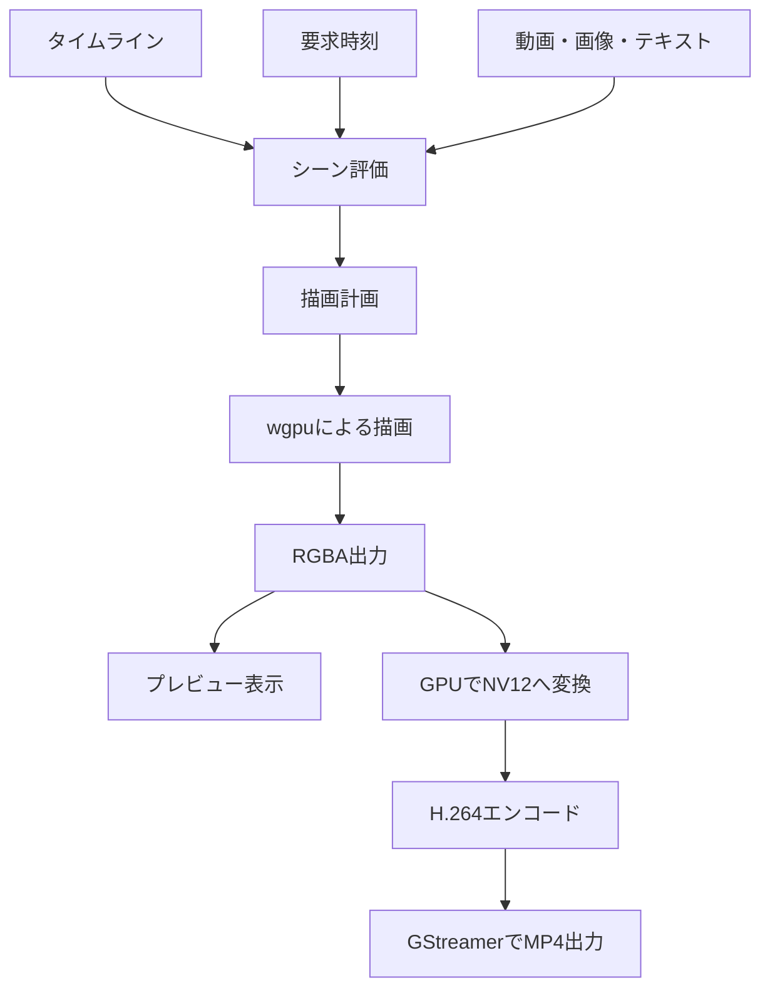
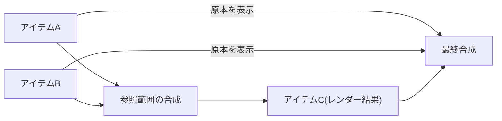

こんにちは、ここ数年ずっと動画編集ソフトが作りたくていろいろな機能を妄想する夜を過ごしたのですが、夏休みをフルベットすることでついにリリースできました。

Zeriumといいます。


https://zerium.pages.dev
https://github.com/1Step621/zerium

目指すコンセプトとしては、

- AviUtlのように初心者フレンドリー
- リッチな編集も可能
- 高い再利用性でつまらない繰り返し作業を減らす
- GPUを利用した高速なリアルタイムレンダリング
- 拡張性の高いプラグイン(未対応)
- クロスプラットフォーム対応
- オープンソース・無料

という感じです。

@[tweet](https://x.com/onestep621/status/2111704317715738725)

## 目玉機能

まだ基本的な機能を実装したのみなので特色を出し切れていないのですが(それでもかなり使いやすいと思いますが！)、ここで目玉機能として紹介したいのがシーン引数機能です。

例えば、テロップのデザインと入退場のアニメーションをまとめて、1つのシーンにしておきます。その中の文章や色を引数として公開すると、シーンを使う側でそれぞれ変更できるようになります。

つまり、一度テロップを作っておけば、あとは文章や色を変えながら同じ演出を何度も使えます。動画の中で何十回も同じテロップを出すような場合に、毎回デザインやアニメーションを組み直さなくて済みます。
さらに、元のシーンを修正すると、それを使っている場所にも変更が反映されます。「やっぱり文字を少し大きくしたい」「背景の形を変えたい」となったときも、元のシーンを直せばまとめて調整できます。


さらに、計算処理を挟むこともできます。


また、この仕組みを流用してパーティクルごとに異なるエフェクトをかけられるようなシステムを作るなど、プログラミングで言う高階関数チックなこともできないかなと考えています(未実装)。

## 技術選定

### 言語

Rustが好きだったのでRustを使いました。

### レンダリング

クロスプラットフォーム対応の良さから、描画全般にwgpuを使っています。GPUデコードには[gpu-video](https://github.com/software-mansion/smelter/tree/master/gpu-video)を利用しています。GPUエンコードは、Linux・Windowsではgpu-video経由のVulkan Video、macOSではvideotoolboxクレートを通してVideoToolboxを利用しています。コンテナの読み書きや音声処理、ソフトウェア処理へのフォールバックにはGStreamerを使いました。

手元の環境(RTX 4060 Laptop)では、H.264, 1080pのクリップ一本のタイムラインなら250fps前後で書き出せます。

### UIフレームワーク

[過去](https://zenn.dev/1step621/articles/8daee458b5140b)に何度もRustで動画編集ソフトを作ろうとしたのですが、日本語入力がまともに動作し、リッチなUIを作ることに向いているフレームワークとなるとかなり絞られますし、TauriなどWebベースのものは、当時試した構成ではIPCでレンダリングしたフレームを送信することに無理があり挫折していました。

そこに彗星のごとく現れたライブラリがGPUIで、メモリ消費を抑えて高級なUIを作ることができます。もう全部これで作るべきと言っては過言ですが、そう言いたくなるくらい気に入っています。

ただ1つ問題があって、Zeriumでは動画フレームのレンダリングにwgpuを採用しているので、wgpuのTextureをCPUに読み戻すことなくプレビュー表示できる必要がありました。採用を検討した時点では、本家GPUI側と動画レンダラー側でGPUリソースをうまく共有する方法が見つからず、ここが悩みどころでした。

そこで、GPUIのコミュニティフォークであるGPUI-CEをベースに、描画とウィンドウ処理をwgpuとwinitに統一した[WGPUI](https://github.com/Far-Beyond-Pulsar/WGPUI)を使うことにしました。WGPUIにはwgpuで描画した結果をUIに組み込める`WgpuSurface`があり、これを使ってプレビューを表示しています。

ハードフォークというとメンテナンスが継続されるかが不安視されるところですが、作者の方がアクティブに開発を続けていることも採用の後押しになりました。万が一止まってしまったら自分でメンテしていく覚悟はあります。

### AI

AIに関する記事は世にたくさん出ていて何なら食傷気味だと思うのであえてここに書くこともないですが、個人的には現状のAI(GPT-6.1 Sol)のコード品質は納得の行くものではなかったので、かなり神経をとがらせてレビューしました。

また、AIコーディング特有の事情として、追加機能の仕様が現状の構造に照らして合理的でない場合でも筋力で実装してしまう場合があり、複雑化の一因になってしまいます。たまに「この仕様のせいで全体が複雑になってるんだよなーみたいなところある？」と聞いてその仕様を削除するなり調整するなりするのがかなり良かったと思います。

## アーキテクチャ

### プラグイン前提の抽象化

プラグインに対応したかったので、その前提で設計しました。ビルトインのアイテムやエフェクトもプラグインの1つとして書かれています。

例えば、幅と高さをプロパティで受け取って画面中央に例の三角形を描くアイテムが欲しければ、plugin.jsonを以下のように書きます。

```json
{
  "api_version": 1,
  "id": "someone.triangle",
  "items": [
    {
      "id": "triangle",
      "label": { "ja-JP": "三角形" },
      "category": "shape",
      "symbol": "▲",
      "properties": [
        {
          "id": "width",
          "label": { "ja-JP": "幅" },
          "type": "f32",
          "default": 640,
          "animatable": true,
          "constraints": { "min": 1 },
          "ui": { "unit": "px" }
        },
        {
          "id": "height",
          "label": { "ja-JP": "高さ" },
          "type": "f32",
          "default": 360,
          "animatable": true,
          "constraints": { "min": 1 },
          "ui": { "unit": "px" }
        }
      ],
      "render": {
        "shader": { "module": "triangle" },
        "vertex_count": 3,
        "bounds": {
          "min": ["-p::width / 2", "-p::height / 2"],
          "max": ["p::width / 2", "p::height / 2"]
        }
      }
    }
  ]
}
```

同じディレクトリにtriangle.weslも作ります。`generated`以下から読み込んでいるのは、後ほどコマンドで生成するインターフェースです。

```wgsl
import package::generated::host::item::quad_position;
import package::generated::triangle::props;

struct VertexOutput {
    @builtin(position) position: vec4<f32>,
    @location(0) color: vec3<f32>,
};

@vertex
fn vertex_main(
    @builtin(vertex_index) vertex_index: u32,
    @builtin(instance_index) instance_index: u32,
) -> VertexOutput {
    let p = props(instance_index);

    let positions = array<vec2<f32>, 3>(
        vec2(0.0, -1.0),
        vec2(-1.0, 1.0),
        vec2(1.0, 1.0),
    );
    let colors = array<vec3<f32>, 3>(
        vec3(1.0, 0.0, 0.0),
        vec3(0.0, 1.0, 0.0),
        vec3(0.0, 0.0, 1.0),
    );

    var output: VertexOutput;
    output.position = quad_position(
        vec2(0.0),
        positions[vertex_index],
        vec2(p.width, p.height),
    );
    output.color = colors[vertex_index];
    return output;
}

@fragment
fn fragment_main(input: VertexOutput) -> @location(0) vec4<f32> {
    return vec4(input.color, 1.0);
}
```

両方のファイルを保存したら、そのディレクトリで以下を実行します。

```sh
zerium plugin generate
zerium plugin validate
```

`generate`でプロパティへのアクセスなどを行うグルーコードが生成され、`validate`で宣言とシェーダーをまとめて検証できます。

画像や動画などの外部入力を使いたい場合は、plugin.jsonを以下のように書きます。

```diff json
{
  "api_version": 1,
  "id": "someone.image",
  "items": [
    {
      "id": "image",
      "label": { "ja-JP": "画像" },
      "category": "media",
      "symbol": "▧",
      "properties": [
        {
          "id": "source_file",
          "label": { "ja-JP": "画像ファイル" },
          "type": "file",
          "default": null,
          "ui": { "extensions": ["png", "jpg", "webp"] }
        }
      ],
      "render": {
        "shader": { "module": "image" },
        "bounds": {
          "min": ["viewport::min::x", "viewport::min::y"],
          "max": ["viewport::max::x", "viewport::max::y"]
        },
+        "inputs": [
+          {
+            "type": "media",
+            "id": "source",
+            "file": "source_file",
+            "reader": "zerium.image"
+          }
+        ]
      }
    }
  ]
}
```

この宣言は、「`source_file`で指定されたファイルを画像として読み込み、`source`という名前の入力として渡してほしい」と伝えています。

シェーダー側のimage.weslは以下のようになります。生成された入力用モジュールから`sample_uv`を読み込むことで、テクスチャやサンプラーのバインディングを直接扱わずに画像を参照できます。

```wgsl
import package::generated::host::item::{quad_corner, quad_uv};
import package::generated::image::inputs::source::sample_uv;

struct VertexOutput {
    @builtin(position) position: vec4<f32>,
    @location(0) uv: vec2<f32>,
};

@vertex
fn vertex_main(
    @builtin(vertex_index) vertex_index: u32,
) -> VertexOutput {
    let corner = quad_corner(vertex_index);

    var output: VertexOutput;
    output.position = vec4(corner, 0.0, 1.0);
    output.uv = quad_uv(vec2(corner.x, -corner.y));
    return output;
}

@fragment
fn fragment_main(input: VertexOutput) -> @location(0) vec4<f32> {
    return sample_uv(input.uv);
}
```

こちらも両方のファイルを保存してから、`zerium plugin generate`と`zerium plugin validate`を実行します。

ほかにも、inputsでは文字を描画した画像を受け取るtextや、別のレイヤーの描画結果を受け取るrender_resultなどを受け取ることができます。これらの入力もホスト側が解決し、後述する描画グラフへ組み込んでいます。

サードパーティプラグインのインストール機能はまだ作っていないのですが、プラグインAPIの互換性を保つ覚悟ができてきたら開放したいです。

### レンダリングパイプライン

プレビューと書き出しは、同じシーン評価・描画処理を使っています。タイムラインと要求時刻から、その瞬間のプロパティやアニメーション、必要な素材を評価し、GPUに渡す描画計画を作ります。プレビューで見えているエフェクトや合成をそのまま書き出しにも使っています。

動画素材はGStreamerでコンテナから取り出し、H.264の圧縮データをgpu-videoに渡してデコードします。対応環境では、GPUデコードした画像にwgpuでエフェクトや合成を行い、その結果をGPU上でNV12に変換してGPUエンコーダーへ渡します。対応するハードウェアがあれば、一連の処理で画素をCPUへ読み戻す必要がありません。GPUデコードが使えない素材や、GPUエンコーダーを初期化できない環境では、GStreamerによるソフトウェア処理にフォールバックします。

書き出しでは素材のデコードとシーン評価、GPU描画、エンコード結果の書き込みを、キューで並行して動かしています。



本丸のシーン評価から描画計画を作る部分では、描画処理を有向非巡回グラフとして扱っています。アイテムの描画、エフェクト、シーンの合成をノードにして、どの描画結果を入力として使うかを依存関係で表しています。

アイテムにエフェクトを順番にかける場合は鎖状になりますが、「レンダー結果」(AviUtlで言うところのフレームバッファや画像合成)アイテムを使って他のレイヤーの状態を参照したり、モーションブラーのように複数の時刻で評価した描画結果を使うエフェクトを使用したりすると複雑なグラフになります。



## 終わり

こういうエフェクトがほしいとかこのプラットフォームで起動したらクラッシュしちゃったとかフィードバックをいただけると非常に助かります。特に今macOSのマシンがなく動作確認ができていないので、動いたり動かなかったりしたら教えていただけるとありがたいです。

GitHubのStarやZennのLikeなどしていただけると励みになります。

https://zerium.pages.dev
